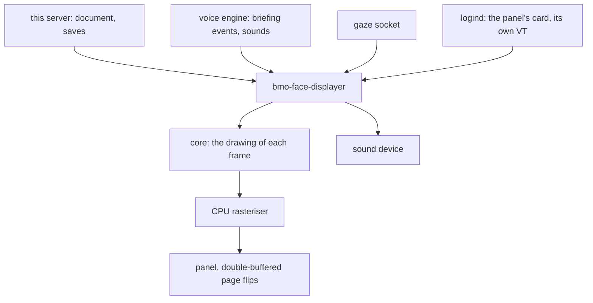

# BMO's face

**Fixed at 0.1.0-rev.1.**

What the face display shows, what BMO sends it and by which road, how a screen signs in, the
expression document both the display and the editor read, the core that draws the face for every
caller, the native displayer that draws it on a machine's own panel, and the server that serves them.

## What stands here

- **The display** — one full-screen web page, `/bmo-face/`, that draws BMO's face in SVG on a teal
  body and moves it on the animation's own held clock: the mouth and the eyes with the sound BMO speaks,
  read from the sound itself, the face with the emotion it speaks with and with what BMO is doing, and
  the eyes with every blink.
- **The native displayer** — `bmo-face-displayer`, a program of its own that does what the display
  does on a machine's own panel, straight through the kernel's display interface, with no browser, no
  window system and no desktop session (「The native displayer」).
- **The editor** — `/bmo-face/edit`, where a person draws and corrects the faces and the talking set
  and tunes how the sound moves them, and saves them. What it saves is what every display shows, with no rebuild and no reload.
- **The core** — the one implementation of the face, a Rust crate with no I/O and no clock of its
  own: it reads the expression document, holds the shapes, does the geometry and the blending, hears a
  sound, and drives speaking, blinking, changing expression and gazing frame by frame. The display and the
  editor's preview draw what its WebAssembly build answers, and a native displayer drawing straight
  to a panel draws what the crate itself answers (「The face's core」).
- **The server** — serves both pages, keeps the expression document, logs the editor in, passes
  a display's requests through to BMO's listener routes, and answers a console for the console screen.
- **The console screen** — the editor again, as a console bundle: a console that keeps bmo-ui's
  console plugin contract finds it by the face's manifest and opens it under `/face`, behind the
  console's own sign-in (「The console screen」).
- **Any screen with a browser.** The case's own screen is not settled, so nothing here assumes a
  board, a resolution or an aspect ratio. A choice that turns on the device is asked of the owner as a
  numbered question rather than guessed.

## What BMO sends, and by which road

- **This road is the web display's, and nothing answers it today.** The app login, the device tokens
  and the listener stream were the old console's and went with the phone app; BMO's console answers
  none of the four routes below, so a display's sign-in fails and the web display hears no briefing
  and no presence. They wait for the briefing unit, the planned owner of a listener stream with
  presence (bmo-chat's `docs/conventions.md`: the speech engine is bmo-voice, the briefings are
  bmo-briefing). The native displayer does not take this road: it listens to the voice engine itself
  (「What it hears」).
- **The road is BMO's own listener stream** — the one every listener hears briefings on. Nothing
  new is opened on BMO's side for the face; the face is one more listener.
- **What the stream carries that the face uses:**
  - `briefing` — a voice briefing went out: the voice message it is, the words, the length, when it
    was sent, the emotion it was spoken with (`기본`, `기쁨`, `슬픔`, `놀람`, `화남`, `졸림`, `폭소`,
    `걱정`, `아픔`, `안간힘`), and the expression it shows, which is what this face's own entry
    answered for that emotion (「The expression entry」).
    - The display shows the expression the event carries; an event carrying none shows its emotion,
      and none of either, or one this display does not know, reads as `기본`.
  - `presence` — what BMO is doing, one state for all of it: `writing` (답 쓰는 중), `thinking`
    (생각 중) or `idle` (쉬는 중), with when it began. It comes once as soon as the stream opens and
    again whenever it moves.
  - `briefing-stopped` — somebody pressed 그만듣기 on any listener; a briefing playing here stops.
  - `keep` — every five seconds, so a quiet stream is told from a dead one.
  - `run` — the name of the bot's run the cursor counts against.
- **The sound** is the voice message itself, fetched from BMO's media route by its chat and message.
  The display plays it and moves the mouth from it; nothing about the mouth is sent.
- **The same-origin pass-through.** A page cannot read another origin's stream with a token header,
  so the display never talks to BMO directly. This server passes exactly four of BMO's routes
  through, under `/bmo-face/bmo/`:
  - `POST /bmo-face/bmo/api/app/login` — signing a screen in;
  - `GET /bmo-face/bmo/api/briefing/events` — the listener stream, with its cursor;
  - `POST /bmo-face/bmo/api/briefing/stop` — 그만듣기;
  - `GET /bmo-face/bmo/api/media/audio/<chat>/<message>` — a briefing's sound, ranges included.
  - Anything else under `/bmo-face/bmo/` is refused here and never reaches BMO.
  - The request's `Authorization` header goes through untouched, with its body, `Content-Type`,
    `Range` and `Accept`; no cookie of this site goes through, and none of BMO's comes back.
  - The answer comes back as it streams, with its status, type, length and range headers; a stream
    is not buffered on the way.
  - A refusal comes back with BMO's status and this server's own one-line answer, never BMO's body,
    which names addresses inside this machine.
  - Where BMO's console is comes from `BMO_CONSOLE_URL` — the live console's address with its base
    path, or the development console's on the bench.
  - A BMO that does not answer is a 502 to the display, which tries again on its own.

## The expression entry

- **`tool.toml` at the repository's root declares the face as a tool of BMO's:** one entry,
  `face/expression`, the expression a briefing shows, for the system alone. It is never shown to a
  session; the voice calls it through BMO's tool host, on the call protocol's first version.
- **The road from the entry to the display is the listener stream:** BMO's briefing runner, as it
  files a briefing's event, calls the entry with the briefing's emotion on the host's control socket
  and puts the expression it answered on the event. The display reads it there like the rest of the
  event; nothing else is opened between BMO and the face.
- **What it is asked and answers:** the emotion a briefing is spoken with, one of the briefing's set,
  or none; it answers the face that emotion shows, `기본` where none was named.
  - The schema holds the emotion to the set a briefing launch is checked against, so the host refuses
    any other before the entry runs.
  - The schema also names `기본` as the emotion's default, and the executable answers that default
    read off the schema placed beside it, so the set and the default are stated once, in the schema.
- **Its executable is the workspace's binary,** started as `bmo-face tool`. It reads the call on
  standard input and answers it on standard output, in the protocol's first version, and reads the
  default off `expression.json` in the folder it is started in.
- **The entry is unbounded:** a call ends when the executable answers or its caller goes away, and the
  host holds no timeout over it.
- **What is placed:** the deployment places the binary with the manifest and its two schemas alone,
  as one folder; nothing else of the face is placed, and a call reads nothing of the face's data
  root.
- **Tested:** the test beside the crate calls the entry with each emotion and with none, holds the
  schema to the briefing's set, and holds the entry unbounded.

## How a screen signs in

- **The display signs in once, the way the Android app did.** The first time a screen opens the
  page it asks for a BMO web account's name and password and posts them to BMO's app login through
  the pass-through. BMO answers with a device token, shown once. BMO's console answers no app login
  today, so this sign-in fails until the briefing unit stands (「What BMO sends, and by which road」).
- **The token is kept in that browser's own storage** and sent as a bearer token on every stream,
  sound and stop request. A screen whose token BMO refuses — revoked on BMO's account screen, where
  the screen stands listed by the name it signed in with — forgets it and asks to sign in again.
- **This server keeps no token and no password** of any screen's. It never sees a token except as a
  header it passes on.
- **The native displayer signs in nowhere.** It reads the voice engine with the engine's own token,
  from the file its setting names (「What it hears」).
- **The editor signs in with a BMO web account too,** checked here against BMO's `web_users`, which
  is opened read-only for that and nothing else. What follows the check is this server's own: a
  session in its own database, the `bmo_face` cookie on `/bmo-face` for seven days, and at most
  twenty failed logins from one address in five minutes.
- **The display itself needs no editor session:** the expression document is read openly, since it
  is drawings and nothing else.
- **The console screen signs in nowhere here.** Whoever the console lets onto it edits; the face
  holds the console's credential and the reader's role to account instead (「The console screen」).

## The faces

- **Ten emotion faces**, one per emotion BMO can speak with: `기본`, `기쁨`, `슬픔`, `놀람`, `화남`,
  `졸림`, `폭소`, `걱정`, `아픔`, `안간힘`.
- **Three state faces**, one per presence: `writing`, `thinking`, `idle`.
- **Which face shows**, first match wins, as the core decides it for every caller:
  1. **Pinned** — a face the caller pins shows whatever else is heard; the editor's preview pins the
     face being edited.
  2. **Speaking** — a briefing is playing: the face the briefing shows, with the talking mouth in
     place of its own and its eyes answering the voice (「The mouth while speaking」).
  3. **Just spoke** — for four seconds after a briefing ends, that face with its mouth closed
     (「The mouth while speaking」), so the feeling does not snap away with the last syllable.
  4. **At work** — BMO is `writing` or `thinking`: that state's face, at once, whatever was held.
  5. **Resting** — BMO is `idle`, which it is until the stream has said otherwise. How long it has
     rested counts from the later of the moment it went `idle` and the end of the last briefing; the
     expression document's `idle` settings say how long each stage lasts (「The expression document」):
     - **held** — until `blank` (ten minutes by default): the face of the last briefing, its mouth
       closed as it closed when the briefing ended, or `기본` where no briefing was heard, or where the
       last one's face has eyes drawn as strokes, so the eyes held go on blinking;
     - **blank** — from `blank` until `asleep`: the `idle` face;
     - **asleep** — from `asleep` (thirty minutes by default): the `졸림` face.
- **A rest that reached `blank` forgets the last briefing.** Told what BMO is doing next, a scene whose
  rest had reached the blank face holds `기본` the next time it rests, until another briefing is heard.
- **A face that is missing** from the document falls back to `기본`, so a document with fewer faces
  still draws.
- **What each default face draws** is the animation's own design, measured frame by frame and
  redrawn clean (`docs/expressions.md`): dot eyes far apart and high, and a small mouth centred well
  below them.

### The held clock

- **The face is drawn on the animation's frames,** 23.976 a second, and every drawing is held for
  whole frames: a change of face's in-betweens and the gaze's steps on twos, the blink frame by frame,
  and, while BMO speaks, the mouth and the eyes every frame, following the sound (「The mouth while
  speaking」), or on twos where the talking set's switch asks for the animation's look. Nothing is
  tweened from one display frame to the next; a drawing is computed when its frame comes and stands
  until the next drawing's frame.
- **Frames are the caller's.** A caller counts frames from a moment of its own and asks the core the
  drawing of a frame and the next frame the drawing may change; it waits until then, or until it hears
  something new. Frames are asked in order.
- **Idle, the drawing is held.** Between blinks nothing moves: the face does not drift or breathe.

### Moving between faces

- **A change of face is drawn as the animation draws one:** a cut about a third of the time, and
  otherwise one to three in-between drawings, each held on twos, blended by correspondence from the
  face that showed to the face that shows next (「Blending one drawing into another」). About three
  changes in ten start with one drawing of anticipation: the face it leaves, every part pressed toward
  its own middle to 85 % of its height, before it moves. An in-between that would cross itself is left out.
- **Element by element, side by side.** Each eye, brow and blush side blends with the same side, the
  mouth with the mouth, part by part in order; a part with no counterpart shows in the nearer half of
  the change alone. Paints and what stands inside a part come from the nearer face, a line's width is
  mixed.
- **A change interrupted** starts its next change from the drawing showing at that frame.
- **A save heard** is drawn at once, as a cut.

### The blink

- **The animation's blink:** the lid half down for one frame, the eye shut in a shallow arc for two,
  half down again for one, then open — four frames, 167 milliseconds.
- **Every four to six seconds,** jittered by seeded chance, and one blink in seven is followed at once,
  after two open frames, by a second.
- **On the same held clock, idle and speaking alike.** A blink waits for no other motion and none waits
  for it, but none starts during a change's in-betweens.
- **Only an open eye blinks.** An eye drawn as a filled closed shape is half covered by cutting away
  its top, and shut as an ink arc 0.9 wide a little wider than the eye across its lower half; a face
  whose eyes are strokes — already closed, as `폭소`'s and `안간힘`'s are — never blinks.

### The gaze

- **Where the eyes look** is a direction from −1 to 1 each way, the middle by default: across, toward
  the screen's right as one faces it; up and down, downward. The display holds it at the middle; the
  editor's preview sets it with two sliders; the native displayer takes it from its gaze socket (「The
  native displayer」). A camera that will one day set it is no part of this unit yet.
- **It moves each open eye within the reach the face's eyes declare** (`reach`, how far each way in
  screen units), and what stands inside an eye — a pupil, a shine — half as far again, cut off at the
  eye's outline as ever.
- **In held steps:** a direction set takes hold at the next frame on twos, never eased; through a blink
  the direction that held as it began stays; an eye drawn as a stroke does not move.

### Less motion

- **A viewer whose setting asks for less motion** (`prefers-reduced-motion: reduce`) is shown every
  change of face as a cut, with no in-betweens. The blink, the talking mouth, the eyes' answer to the
  voice and the gaze's held steps stay: they are how the face speaks and looks alive, and each frame of
  them is a drawing of its own, held until the next.

## Hearing the sound

- **The face is moved by the sound itself.** Every caller decodes a briefing's sound whole before it
  plays and hands its first channel's samples to the core, which reads them into what the face hears at
  each frame of the held clock; the display, the editor's preview and the native displayer hear one
  sound alike.
- **What each frame holds:**
  - its **level** — the root mean square of the frame's own samples, in dBFS, silence at −120;
  - its **spectrum** in sixteen bands of seven sixteenths of an octave from 80 Hz to 10,240 Hz (edges
    80, 108, 147, 199, 269, 364, 494, 668, 905, 1,226, 1,660, 2,248, 3,044, 4,123, 5,583, 7,561 and
    10,240 Hz), each band the mean square its share of the sound would have alone, in dBFS, so a band
    holding the whole of a sound reads its level;
  - its **centroid** — the frequency the energy between 80 Hz and 10,240 Hz centres on, nought for
    silence;
  - its **flux** — how much the spectrum's magnitude rose since the frame before, as a share of its
    own, from nought to one: a sharp start reads high;
  - whether it is **voiced** — louder than −60 dBFS, more of its energy below 905 Hz than above
    3,044 Hz, and crossing nought fewer than 3,000 times a second.
- **How it is read.** A frame's samples are those from the sample its start rounds to up to the one the
  next frame's start rounds to. Its spectrum is the mean of two transforms, each over a periodic Hann
  window as long as the power of two nearest one frame's samples — 2,048 at 48 kHz — centred a quarter
  and three quarters of the way through the frame, so the windows overlap by half and every sample
  weighs alike; samples before the first and past the last count as silence. Nothing is smoothed here:
  the speaking driver smooths what it draws from these readings.
- **One implementation.** The transform is rustfft's radix-4 transform in single precision, built
  without its SIMD paths, and the logarithms and cosines come from `libm`, the pure-Rust mathematics
  library: the same operations in the same order natively and in the WebAssembly build, so the two hear
  a sound alike to the bit, but where the transform's own twiddle factors, which rustfft computes with
  the platform's sine and cosine, differ in their last bit — they can move a band's reading by a few
  millionths of a decibel. The web's test holds its build's hearing of a fixture to the native one's
  within a thousandth of a decibel, and no closer.
- **At any rate.** The web display opens its audio at 48 kHz, as the voice's Opus is coded, so both
  displays hear the same samples; a sound at another rate is read with a window the power of two
  nearest its own frame, and a band above half its rate stands silent.
- **A voice to try.** The core makes a sample of its own for the editor, the shots and the tests: about
  five seconds of a formant-synthesised voice saying the five vowels one by one, then "sa", "ma", "so"
  and "simu", with pauses between, a sawtooth voice falling from 140 to 115 Hz through a vowel's three
  resonances and a fourth at 3,300 Hz every voice holds, brightened as the lips radiate it by a first difference, and noise through a double
  difference for a hiss.

## The mouth while speaking

- **The talking set** (「The expression document」) is the drawings the talking mouth passes through,
  its anchors, and the tuning of how the sound moves it. Each anchor stands at a place on a plane of
  how open a mouth is and how wide, each from nought to one, and the anchors whose teeth stand together
  on a plane of their own. Speaking draws, at every frame, the mouth the sound calls for over the face in
  place of its own (「The talking set」).
- **What the sound calls for at a frame,** before it is smoothed:
  - **open** — the level's place between quiet and loud, quiet being `range` dB below the sound's own
    loud level (the level 95 % of its frames above `floor` stay under) and never below `floor`; times
    `open`; with the share `jaw` of it decided by where the first formant stands — the centre of the
    energy in the `lowHz` band, from closed at the first of `jawHz` to fully open at the second — so an
    open vowel opens wider than a close one; and closed by up to seven tenths with the hiss;
  - **round** — how little stands above a rounded vowel's two formants: the energy in the `roundHz`
    band against the energy from the start of the `lowHz` band up to the start of `roundHz`, not round
    at all where it stands 18 dB below and fully round at 30 dB below, times `round`. /o/ and /u/ hold
    both their formants under that band, so they round the mouth, while /a/, /e/ and /i/ reach into it
    and spread it. The second formant's own centre does not decide it: read by bands, it barely
    moves between /o/ and /a/, and the first formant's band holds the second formant of a back vowel
    as well. A frame heard but not voiced keeps the roundness before it, and a frame under quiet lets
    it go;
  - **teeth** — the hiss: how far the `highHz` band stands over the louder of the two formant bands,
    from nought at even to whole six decibels over, times `teeth`, so a sibilant draws the slit of
    teeth together. A voiced frame stands well under even, at ten decibels or more below in a measured
    voice;
  - **tongue** — on a voiced frame, the openness past 0.45, whole at 0.8, times `tongue`;
  - **voice** — one while the level stands above quiet, nought below: how far the talking mouth stands
    in for the face's own.
- **Followed with a light smoothing:** each of these follows its aim as a one-pole filter a frame long,
  the openness rising over `attack` (25 ms) and falling over `release` (60 ms), the roundness, the teeth
  and the tongue over `glide` (60 ms) both ways, and the voice rising over `glide` and falling over
  `rest` (300 ms), so the mouth closes in the gaps between syllables and goes back to the face's own
  in a pause. Each value is held to a thousandth, so frames that would draw alike are one drawing.
- **The mouth a shape draws.** Its place on the plane is its openness, held to the openness the anchors
  span, and its roundness taken across the widths the anchors reach at that openness — the widest at
  nought, the narrowest at one. The anchors' places are cut into triangles that meet edge to edge, no
  triangle's circle holding another place (Delaunay's construction), and the mouth is the blend by
  correspondence (「Blending one drawing into another」) of the three anchors round its place, weighed
  by where it stands among them — two along an edge, one at an anchor, which then draws exactly as it
  stands; anchors on one line are blended along it. The teeth plane draws its own mouth for the same
  shape, and the teeth are the share of the way from the first mouth to it. A line meeting an opening is
  first drawn as the thin closed band its stroke covers, half the line's width wide and round at both
  ends, so an opening grows from round ends and never from points.
- **The tongue** is pressed down into its own base to the tongue's share of its height, and left out
  below a twentieth.
- **The corners.** Each face says how far its talking mouth's corners lift while it speaks, from −1,
  dropped, to 1, lifted (`corners` of the face), and the tuning's `corners` how far that is in screen
  units for a mouth 30 wide, a narrower one less in proportion: every point of the mouth moves straight
  up or down along a parabola across its width, the ends by the whole and the middle not at all. Moving
  points straight up or down by their place across alone never makes a drawing cross itself.
- **Silence closes the mouth.** The mouth drawn is the face's resting mouth blended to the talking
  mouth by the voice, so the first syllable grows out of it and a pause returns to it.
  - **A face whose own mouth is a line** rests on its own mouth.
  - **A face whose own mouth is open** — one holding a filled closed part, as `기쁨`, `놀람` and `폭소`
    do — rests on a closed mouth instead: one ink line as wide as the talking mouth of the last shape
    heard above quiet, standing level across that mouth's middle, its corners lifted by the face's
    `corners` as the talking mouth's are. A face that lifts its corners closes in a smile, deeper the
    wider the last mouth was, so a spread vowel closes smiling and a rounded one nearly level; a face
    that drops them, or lifts them not at all, closes in a level line. Before anything is heard the
    last shape is the closed, widest one. For such a face the talking mouth stands in only as far as
    it is open as well: below an openness of a tenth it gives way to the closed mouth in proportion,
    so a talking mouth that has shut in a pause draws as the closed mouth, never as the talking set's
    own closed lips.
  - **After the briefing** the face held keeps the closed mouth its last pose rested on (「The
    faces」). A talking set that draws nothing leaves the face its own mouth.
- **The lead.** The animation's mouth leads its voice by two frames, so a frame shows what the sound
  calls for two frames later, and the first drawing shows two frames before the sound is heard.
- **Every frame, or on twos.** By default the mouth and the eyes follow the sound every frame, as a
  visualiser would. With the talking set's `onTwos` switch, the same poses are sampled on twos — each
  pair of frames shows the first one's — for the animation's held look.
- **Timed text bends the mouth where a briefing carries it,** but the sound decides. A cue is a run of
  the spoken text and the frames of the sound it is spoken over; its sounds are spread evenly across
  them. A rounded vowel (O, U, W) moves the roundness `cues` of the way to round, an open vowel (A) the
  same share to wide, and the lips meeting (P, B, M) close the openness by `cues`. Korean is read the
  same way by extrapolation: ㅁ, ㅂ, ㅃ and ㅍ close the lips at a syllable's start or end, ㅗ, ㅜ
  and the vowels built on them round them, ㅏ and ㅑ open them. Today's briefings carry no timed text.
- **Nothing is chance.** The same sound, document and face draw the same mouth at every caller; no
  seed reaches the speaking.
- **The face follows the briefing while the mouth talks.** The briefing's expression selects the face
  for as long as it speaks; the driver only replaces the mouth and moves the eyes. A briefing could carry
  changes of expression at times within its sound — the core takes a list of faces, each from a frame of
  the sound — but BMO's briefing event names one expression, so the display hands the core one. A timed
  list needs BMO's briefing event to carry each expression with the moment of the sound it starts at,
  and the face's entry to answer each; neither is this unit's to change.
- **The lead the display reaches.** The whole sound is decoded before it plays, so every pose stands
  before the first sample: the display starts the sound on the audio clock so that it is heard two
  frames after the first drawing shows — earlier by the output latency the browser reports, so the sound
  leaves the speaker on that frame — and keeps the face on the frame clock from there. A browser that
  reports no output latency leads by two frames less what its own output path delays.
- **Heard or silent.** By default the display plays the sound. With `?sound=off` in its address it
  plays nothing and moves the face from the same decoded sound, for a case whose sound comes from
  somewhere else.
- **A briefing that is late** — sent more than two minutes before the display hears of it, as after
  a reconnect — is not played, the same rule every listener keeps.
- **그만듣기** stands on the display while it speaks. It stops the sound here and posts the stop, so
  every other listener stops too; a stop from anywhere else stops it here.

## The eyes while speaking

- **A restrained answer to the voice.** While a briefing speaks, each open eye grows taller about its
  own middle with the level — followed over `attack` and `release` — times `eyePulse`, and with the
  flux, which rises at once and falls over 250 ms, times `eyeOnset`; it grows shorter through a long
  loud stretch — the level averaged over 1.5 s, past half — times `eyeSquint`; and its shine, a part
  inside it painted `light`, grows about its own middle with the hiss, times `eyeShine`.
- **Each eye bounds its own answer.** A face's eyes say how far they answer (`voice` of the eyes:
  `grow`, `squint` and `shine`, each a share of the eye's own size, at most a half); the pose's amounts,
  from nought to one, are taken of those bounds, so a face stays the face it is. The default eyes take
  theirs from the eye set (`docs/expressions.md`, 「The eye set」); an eye drawn as a stroke, already
  closed, never answers, whatever it says.
- **The blink wins.** While a blink plays, the eyes do not answer; the gaze then moves the answered eye.

## The expression document

- **One JSON document** in the data root, `faces.json`, which the display reads and the editor
  writes. A server starting with none writes the default the core draws.
- **What it holds:**
  - `form` — `3`, the form this document is written in; a document of an older form is carried into
    this one as the server starts (「Preparing the document」).
  - `colors` — the body and the screen, and the seven paints a part is drawn in: `ink` (the lines,
    eyes and outlines), `light` (the teeth and an eye's shine), `mouth` (the inside of an open mouth),
    `tongue` and `tongueLight` (the tongue's two tones), `cheek` (the blush) and `tear`. Each is a
    `#rrggbb` colour.
  - `faces` — one face per name above. A face is its elements, drawn in this order, each over the
    ones before it:
    - `blush`, `eyes` and `brows` — each a **pair**: its `left` parts, and its `right` parts or `null`
      where the right is the left reflected across the screen's middle, which it is by default, so an
      eye is drawn once and mirrored, or each side drawn on its own. `eyes` also holds `reach`, how far
      in screen units each eye moves each way with the gaze (「The gaze」), at most 6, and `voice`, how
      far each eye answers the voice — `grow`, `squint` and `shine`, each a share of its own size from
      nought to a half (「The eyes while speaking」).
    - `mouth` — its parts: an open stroke for a closed mouth, or a closed outline filled `mouth` with
      the teeth and the tongue standing inside it.
    - `marks` — tears, sweat and whatever else is drawn over the face.
    An element may be empty. A face also holds `corners`, how far its talking mouth's corners lift
    while it speaks, from −1 to 1.
  - `talk` — the talking set (「The talking set」): its `anchors`, one to thirty-two, each its `at`
    (how open and how wide, each from nought to one), whether its `teeth` stand together, and its
    `parts`; and its `tuning`.
  - `idle` — how long BMO rests before its face changes (「The faces」), each in seconds from nought to
    86,400: `blank`, when the held face gives way to the `idle` face, 600 by default; and `asleep`, when
    that gives way to `졸림`, 1,800 by default and never before `blank`. The editor shows neither and
    keeps both as they stand.
  - `savedAt` — when it was last saved, which is also its version.
- **A part** is one path (「How a path is written」), in the screen's own coordinates, a box one
  hundred wide and seventy-five high, with:
  - **open or closed**: a closed path runs on from its last node back to its first.
  - its **fill** — a paint, or none; only a closed path is filled.
  - its **line** — a paint, or none, and its width, drawn with round ends and round joins. A part
    has a fill, a line or both.
  - what stands **inside** it — only for a closed path: parts drawn within its outline and cut off
    at it. They are drawn after its fill and before its line, in order, so the outline stays over
    the edge where they are cut. A part inside may be open or closed, and holds nothing inside it.
    This is how an open mouth is drawn: its outline filled `mouth` as the cavity, and inside it the
    upper teeth band and the lower one filled `light`, and the tongue in its two tones, `tongueLight`
    showing as a rim along the top of `tongue`; and how an eye holds a pupil or a shine.
- **The paint is the part's own.** A part names the paint it is filled and lined with; nothing takes
  a colour from the element a part stands in.

### The talking set

- **The anchors** are the drawings the talking mouth passes through: each draws exactly as it stands
  when the sound calls for its place, and the mouths between are blended from them (「The mouth while
  speaking」). No two anchors of one plane — the open mouths, or the teeth together — stand within
  0.005 of each other both ways.
- **Where an anchor stands is measured from its drawing** when the core draws it or carries it from an
  older form, and the editor offers the same measure: how open, the height of its closed parts over
  20.2 units — the largest round O's — or nought for lips drawn as a line; how wide, its width from 6
  units at nought to 44 at one; and its teeth together where a band painted `light` inside its opening
  reaches four tenths of the opening's height. The editor may then move it anywhere.
- **The tuning** is every value of how the sound moves the face, each with its bounds and default:

  | Key | Holds | Bounds | Default |
  | --- | --- | --- | --- |
  | `floor` | the quietest level that opens the mouth, dBFS | −90 to −20 | −55 |
  | `range` | how far below the sound's loud level the mouth starts to open, dB | 6 to 60 | 30 |
  | `open` | the openness at the loud level | 0 to 2 | 1 |
  | `jaw` | the share of the openness the first formant decides | 0 to 1 | 0.35 |
  | `round` | how strongly a rounded vowel rounds the mouth | 0 to 2 | 1 |
  | `teeth` | how strongly a hiss shows the teeth | 0 to 3 | 1 |
  | `tongue` | how strongly an open voiced sound shows the tongue | 0 to 2 | 1 |
  | `corners` | how far a mouth 30 wide lifts its corners at a face's full lift, screen units | 0 to 4 | 2 |
  | `attack`, `release` | how fast the mouth opens and closes, ms | 0 to 500, 0 to 1,000 | 25, 60 |
  | `glide` | how fast the roundness, teeth and tongue follow, and the voice rises, ms | 0 to 1,000 | 60 |
  | `rest` | how slowly the mouth goes back to its resting mouth in a pause, ms | 0 to 2,000 | 300 |
  | `eyePulse`, `eyeOnset`, `eyeSquint`, `eyeShine` | how strongly the eyes answer the level, a sharp start, a long loud stretch and the hiss | 0 to 1 | 0.4, 0.6, 0.7, 1 |
  | `cues` | how far a timed text bends the mouth | 0 to 1 | 0.5 |
  | `lowHz`, `midHz`, `highHz` | where the first formant is sought, the second, and the hiss, Hz | within 80 to 10,240, the first below the second | 250–1,000, 900–2,800, 3,500–10,240 |
  | `jawHz` | the first formant at which the jaw is closed and fully open, Hz | as above | 350–750 |
  | `roundHz` | the band above a rounded vowel's two formants, read against the energy under it, Hz | as above | 1,650–3,000 |
  | `onTwos` | the mouth and the eyes on twos rather than every frame | true or false | false |

### How a path is written

- **A path is a run of cubic Bézier segments, as many as its shape needs.** Its nodes, two to
  thirty-two of them, each an anchor the path passes through and two handles held as offsets from the
  anchor: the one the path comes in by and the one it leaves by. Between two nodes the path is the
  cubic Bézier curve from the first anchor, pulled by the first node's leaving handle and the second
  node's coming handle, to the second anchor. A shape of two segments and one of seventeen are written
  alike, and a blend between them adds or takes away segments as it needs, never a fixed count.
- **Nodes are smooth by default.** A smooth node's two handles stand on one line through the anchor,
  which the editor keeps as either is dragged; a corner's handles move apart. A handle of no length
  pulls nothing, so a node with both handles at nothing is a sharp corner and two such nodes are joined
  by a straight line. The drawing reads only the handles.
- **A smooth run through points** — what the shapes are built from and what a node made smooth from
  nothing takes — gives each inner node a leaving handle a sixth of the step from the point before it
  to the point after it, and its coming handle that step reversed; the end of an open run leaves along
  the parabola its first three points make, so three points draw an arc, never two strokes meeting in a
  bend. A closed run's neighbours run round; two points are a straight line.
- **Ends are round.** Every line is drawn with round caps and round joins, and an open mouth's two
  ends are turned on a radius of 0.36 of its height (half its height for a round O), as the animation
  turns them.
- **The drawn form is the written form.** The display draws every segment as written, a closed path
  closing on its first anchor; nothing is resampled into pieces.

### Blending one drawing into another

How an in-between of two parts is found (「Moving between faces」), so that it never folds:

1. **Both paths are brought to one winding and one start.** A closed path runs clockwise on the
   screen and is cut into two runs between its leftmost and rightmost points: over its top, and back
   under its bottom. An open path runs from its left end to its right.
2. **An open line meeting a closed shape is turned into a closed loop** that runs out along the line
   and back along itself, so it opens as a mouth opens rather than folding. The closed shape is then
   cut where it stands, seen from its middle, in the direction of the line's two ends, and taken first
   the way the line bows: under its bottom for a line bowing down, over its top for one bowing up.
3. **Each pair of runs is brought to one count of segments.** A straight segment is first written to
   move at an even pace, its control points a third of the way along, which draws the same line. Each
   run is then cut wherever the other has a node, by the share of its length behind that node, and a
   run that still has fewer is made up by splitting its longest segment at its middle; neither changes
   either drawing. The segments then pair in order of the length behind them.
4. **The paired segments are mixed control point by control point.**

The core's tests hold every in-between of every two default faces, at shares from a tenth to nine
tenths, to never crossing itself, never turning inside out and never reaching past the box of the two
drawings it stands between — which is where a hook would grow.

### Saving is checked

- **A document is refused whole** unless it is of this form, every face, part and anchor is well formed
  and within the screen and every tuning and `idle` value within its bounds — every anchor and the end of every handle — and it must name the
  version it was edited from: one saved in between is a conflict, refused, and the editor says another
  window saved first. A list of parts holds at most sixteen, a part at most eight inside it, and a line
  is between 0.2 and 10 wide.
- **A refusal is a code and a place.** The check answers why — `node-count`, `off-screen`,
  `line-width`, `anchor-place`, `tuning`, `idle` and the like — and where, from the outside in: a colour, a
  face, an element, a side, an anchor, a part, a part inside it, a node, each counted from one, or a
  tuning or `idle` value by its key, with the limits the code turns on. The editor words it from its language pack; the server answers it under `refusal` beside an
  English `error` line.
- **One check, in the core.** The server checks with the core crate, and the editor with the same
  crate's WebAssembly build before it sends anything, so the two cannot drift.
- **The default is drawn once,** in the core, from its eye and talking sets.

### Preparing the document

- **The document is prepared once, when the server starts,** before it answers any request, so a
  display and the editor only ever receive a document the check passes. After that a read only
  reads: nothing a display asks for writes the document, and only a save does.
  - no document: the default is written;
  - a document never saved from the editor — `savedAt` of zero — is the default drawn into an older
    build, and is replaced by the default drawn now;
  - a saved document holding no face for a name the default draws is given the default's face for
    it, written in place with its version unchanged, so a face added here reaches a document saved
    before it rather than falling back to `기본`; colours it does not hold come from the default;
  - a saved document of this form is given the tuning and `idle` values it lacks from the default,
    written in place with its version unchanged;
  - a saved document of an older form is carried into this one by the core, with the default's `idle`
    values, and written in place with its version unchanged:
    - **form 2** talked in families of mouths, picked by chance and held on twos. Each mouth of every
      family, in order, becomes an anchor at the place measured from its drawing (「The talking set」),
      leaving out one the check refuses, one that draws nothing and one standing within 0.005 both ways
      of an earlier one of its plane, up to thirty-two; where none is left, the default's anchors stand
      instead, and the tuning is the default's. A form 2 document whose set was never edited — the
      default's own — is carried to the default's anchors exactly, as they are measured from the same
      drawings in the same order. Each face takes the default's `corners` for its name, and its eyes the
      default's `voice` for its name where they draw as the default's eyes do, else a dot eye's where
      they are filled shapes and none where they are strokes. Every drawing stays as it was drawn.
    - **form 1** drew a face in five groups and the speaking mouth as a ladder of stages. Its `eyes`,
      `brows` and `cheeks` become the pairs `eyes`, `brows` and `blush`: a part whose anchors stand left
      of the screen's middle on the left, the rest on the right, and the right left out — mirrored —
      where it draws the left reflected, whichever node each starts at and whichever way each runs. Dot
      eyes take a reach of 2.2 across and 1.6 up and down, stroked eyes none. `mouth` and `marks` stay
      as they are, and the stages give way to the default's talking set; the face is then carried as a
      face of form 2 is. Every path stays as it was drawn.
    - **form 0** drew a part as an ellipse or as a curve through points, and is carried through form 1:
      a curve becomes a path whose nodes are those points, each smooth, its leaving handle a sixth of
      the step from the point before it to the point after it and its coming handle that step reversed
      — the end of an open curve standing for its own missing neighbour — so it draws as it drew; an
      ellipse becomes four smooth nodes at the ends of its radii, each handle 4/3·(√2 − 1) ≈ 0.5523 of
      its radius long; a filled ellipse is filled and has no line, an unfilled one a line and no fill, a
      curve a line and a fill of the same paint when closed and filled; a part in `cheeks` is painted
      `cheek` and every other part `ink`; a handle whose end falls outside the screen is shortened along
      itself to the screen's edge.
    - This carrying is the one place anything reads an older form's group names.
  - a document the check still refuses is moved aside, beside it, as `faces.json.broken-` and the
    time in milliseconds — never deleted — and the default is written in its place. The server says
    so on its error output.
  - whatever preparing writes, the server says on its output which of these it was; a document
    left as it stood is not mentioned.
- **Every open display hears a save** on a small stream of this server's own,
  `/bmo-face/api/faces/events`, and draws the new document at once.

## The face's core

- **One crate, `core/`, is the face's one implementation:** the document read, checked and carried
  from its older forms; the eye and talking sets; the geometry of a path; the blend; the hearing of a
  sound and a voice sampled to try it on; the drivers of speaking, blinking, changing expression and
  gazing; and which face shows. It does no I/O, keeps no
  clock and depends on no platform. The server uses it as a crate; the display and the editor use its
  WebAssembly build; a native displayer uses it as a crate.
- **Its one question:** given the document, what the caller has told it and a frame of the held clock,
  which drawing shows — deterministic for a seed: the same seed, document and events give the same
  drawings to every caller. The seed draws the blinks and the changes of face; the speaking turns on the
  sound alone.
- **The scene is what a caller holds,** made from a checked document, a seed and the frame the caller
  starts counting at. A caller tells it:
  - a document saved since, drawn at once;
  - what BMO is doing, with the frame it began;
  - a briefing to speak: what is heard of its sound, one reading a frame from its first frame, as the
    core's own hearing answers it (「Hearing the sound」); the timed text it says where known, each cue
    its text and the frames of the sound it is spoken over; the face it shows, and the faces it moves to
    at frames of the sound; and the frame its first frame is heard at;
  - that the sound stopped, at a frame;
  - where the eyes look from a frame on, −1 to 1 each way;
  - a face to pin, or none;
  - whether expression changes are calm (cuts alone) and whether the eyes blink.
- **And it asks it:** the drawing a frame shows, and the next frame after it where the drawing may
  change — none where nothing will change until it is told something. Frames are asked in order. It
  also answers what the face hears of a sound's samples, the voice it samples, what the face does at
  each frame of a sound under a tuning, and where a drawing stands among the talking set's, for the
  callers to hand back and the editor to draw.
- **The drawing** is the screen's size in document units (100 by 75), the body's and the screen's
  colours, a list of clip outlines, and the paint to lay down in order. Each paint is a path filled, or
  a path stroked with its width — always with round caps and round joins — in a `#rrggbb` colour, and
  names the clip outline it is cut off at, if any. A path is its start point and each segment's two
  control points and end, with whether it closes on its start. Numbers stand to a thousandth of a unit.
  The screen's rounded rectangle is the caller's to draw: on the web it stands six units round at its
  corners.
- **What a native caller does:** scales the document's units to its panel — 1024 by 600 is wider than
  4:3, so the 100 by 75 screen stands centred at 800 by 600 with the screen's colour filling the panel whole —
  rasterises each paint in order with its clip as a mask, counts frames at 23.976 a second from its own
  monotonic clock, hands the core the samples of the sound it plays to hear before it plays them, tells
  the scene the frame the sound's first sample will be heard at, and draws when the next change comes. The scene asks nothing of its caller and never blocks.
- **The WebAssembly build** is carried in the repository, under `src/wasm/`: the binding's glue and
  types, the module's bytes written into a JavaScript module, and the hash of the sources it was made
  from. `bun scripts/core.ts` makes it again — `cargo rustc` for `wasm32-unknown-unknown` under the
  workspace's size-optimised `wasm` profile, then `wasm-bindgen` at the version the crate locks — and the
  root's test fails while the build is not made from the core's sources as they stand. The screen
  imports it through `src/core.ts`, which instantiates it on import and types what it answers; the
  binding hands JSON text and plain numbers across and holds no logic.
- **Tested** by its own tests, natively: the check and its refusals, the carrying of every older form
  on the old defaults and the old fixtures, the geometry, every blend of every two default faces, the
  hearing of silence, tones, a hiss and the sampled voice, the speaking driver's opening, closing,
  rounding, teeth and smoothing, the talking mouth never crossing itself across its whole plane and every
  lift, the anchors drawn as they stand, the eyes held within what they allow, the same samples drawing
  the same faces, the timed text in English and Korean, the blink's sequence, rate and doubles, the
  change's cuts and in-betweens, the gaze's held steps, the rest's held face, blank face and sleep at the
  document's `idle` settings, work breaking the hold, the closed mouth's smile after a spread vowel and
  its level line after a round one or under dropped corners, and a scene's every change of drawing
  announced by the frame it named. The root's test holds the WebAssembly build's hearing of a fixture to the native
  hearing written beside it.

## The editor

- **`/bmo-face/edit`, behind the editor's login.** Without a session it shows the login and nothing
  else.
- **Two tabs, edited apart:**
  - `감정 표정` — one face at a time, chosen by name: the ten emotions and the three states. A face
    is edited one element at a time — eyes, brows, blush, the resting mouth and the marks — and the
    eyes, brows and blush one side at a time.
  - `말하는 입` — the talking set, one anchor at a time, chosen by its number. Its place, how open and
    how wide, and whether its teeth stand together stand beside it, with a button that places it where
    its drawing measures (「The talking set」). Anchors are added, a copy of the one being edited
    standing a twentieth more open (less, at the top), and removed, down to one. The tuning stands
    beside them too (「Tuning by ear」).
  - Both tabs edit parts the same way, parts inside a part included.
- **A pair's two sides.** The eyes, the brows and the blush hold a switch, 좌우 대칭, on while the
  right side is the left reflected. While it is on, the right side is not edited: it stands dimmed on
  the canvas, and the side select offers the left alone. Turning it off gives the right side the left's
  reflection to edit on its own; turning it on again drops the right side's own drawing.
- **How far the eyes look and answer.** The eyes hold the reach of the gaze across and up and down,
  two numbers from 0 to 6, and how far they answer the voice — 커짐, 찡그림 and 반짝임, each from 0 to
  0.5. The resting mouth holds the face's 입꼬리, how far its talking mouth's corners lift, from −1 to 1.
- **The canvas** is the screen at the display's own proportions, with the face or mouth being edited
  on it. The parts being edited carry handles; the rest of the face stands dimmed behind them for
  reference, each part in its own paints.
  - Every node of a part has a handle on its anchor. The chosen node also shows the ends of its two
    handles, each on a thin line to its anchor; a handle of no length shows none.
  - Dragging an anchor moves the node with its handles. Dragging a handle's end moves that handle;
    on a smooth node the other handle turns with it to stay on the same line, keeping its own
    length. Nothing is dragged outside the screen.
  - Every anchor and handle end the editor moves lands on a tenth of a screen unit, and a handle is
    kept as its landed end less its landed anchor.
  - Pressing a part chooses it and its handles stand larger; pressing an anchor chooses that node.
- **Parts inside a part.** A chosen closed part lists what stands inside it. Choosing one of those
  edits it on the canvas with the same handles, the outline around it standing dimmed as the edge it
  is cut off at; going back chooses the outline again.
- **The chosen part's numbers** stand beside the canvas, and editing a number moves the part as
  dragging does:
  - the part: open or closed, the fill's paint or none, the line's paint or none, the line width.
    The fill is offered only for a closed part. Opening a part drops its fill — a part with no line
    takes its fill's paint as a line, so it still shows — and a part with anything inside it cannot
    be opened until what is inside is removed.
  - the chosen node: its anchor, its two handles as offsets from the anchor, and smooth or corner.
    A handle can be pulled in to nothing, which makes a sharp corner.
  - each number is a box with its two step buttons, each naming itself in a tooltip, laid out as
    BMO's console lays its own: on a narrow screen, under 640px wide, − at the box's start and + at
    its end; on a wider one an up and a down arrow stacked at its end.
  - making a node smooth:
    - when its leaving handle has a length, its coming handle turns to stand opposite it, keeping
      its own length, or taking the leaving handle's length when it had none;
    - when both handles are nothing, the node takes the handles of the smooth run through its part's
      anchors (「How a path is written」). This is how a sharp corner is pulled out again on the
      canvas, where a handle of no length shows no end to drag.
- **Parts are added and removed** in what is being edited: an oval (a closed path of four smooth
  nodes, the size of a dot eye) or a line (an open path of three smooth nodes). Inside a chosen closed
  part: the upper teeth band hanging from the top of the opening, the lower one rising from its
  bottom, the tongue, the tongue's light tone, or a shine high on its left.
  - Everything the editor makes is made from its one create button (「The screens' shared style」),
    named 모양 추가 in the face tab and 모양·입 추가 in the talking mouth tab. It opens one menu: the
    oval and the line; the parts inside under 안쪽 모양 while a closed part of the target's own is
    chosen, offered as long as it holds fewer than it may; and, in the talking mouth tab, a new anchor,
    as the talking set's anchors are added. An entry that cannot be made now stands disabled.
  - What stands inside a chosen part is listed beside the canvas only once it holds something.
  - A new part comes with its own paints, whatever element it is added to: an oval filled `ink` with
    no line, a line in `ink` 0.8 wide, a teeth band filled `light`, a tongue filled `tongue`, its light
    tone filled `tongueLight`, a shine filled `light`. The core draws each, sized to the part it stands
    in.
  - A node is added after the chosen one by splitting the segment it leaves by at its middle, which
    leaves the drawing as it was — at the end of an open path, the segment coming into it — and so a
    path takes as many segments as its shape needs.
  - Removing a node removes the chosen one, down to two.
- **The preview** beside the canvas is the core's own drawing of the face being edited, on the held
  clock, as a display draws it: it blinks as a display does, which a switch, 깜빡임, turns off, and two
  sliders, 시선 가로 and 시선 세로, turn the gaze. In the talking mouth tab it shows the anchor being
  edited in `기본`'s face while it is not speaking.
- **Speaking in the preview.** 예시 소리 plays the core's sampled voice aloud and 소리 파일 a sound
  file the person picks, decoded in the browser at 48 kHz; the face being edited speaks it as a display
  would, with the document as it is being edited, and 정지 stops it. Beneath the face a strip draws what
  is heard: the sixteen bands as a heat map across the sound's frames, the level, and the openness,
  roundness and teeth the tuning draws from it, the frame being shown marked as it plays. Played again,
  a sound is heard with the tuning as it then stands.

### Tuning by ear

- **The tuning stands in the talking mouth tab** beside the anchor's numbers, in four groups: 소리
  (`floor`, `range`, `lowHz`, `midHz`, `highHz`), 입 (`open`, `jaw`, `jawHz`, `round`, `roundHz`,
  `teeth`, `tongue`, `corners`, `cues`), 시간 (`attack`, `release`, `glide`, `rest` and the switch 두
  프레임씩) and 눈 (`eyePulse`, `eyeOnset`, `eyeSquint`, `eyeShine`). Each is a number box with its
  bounds, a span two boxes; each is named in the language pack and its tooltip says what it moves.
- **A value is saved with the document,** as any edit is, and a display draws it from the next
  briefing it speaks.
- **Saving** sends the whole document with the version it was edited from. A save refused by the
  check says why beside the save button, in the language pack's words for the refusal's code and
  place; one refused because another window saved first says so and offers to load the saved
  document, dropping what was edited here.
- **Changes not yet saved** are marked beside the save button, and the button is only pressable
  while there are some.
- **On a phone** the canvas takes the screen and the numbers and the preview open from one button,
  in a drawer from the bottom.

## Showing on any screen

- **The face fits the screen it is on.** The body fills the whole viewport in any aspect ratio, and
  the screen with the face keeps its own proportions, centred and as large as the body allows.
- **Full screen** is asked for on the first tap, which a browser allows only after one.
- **The browser may refuse to play sound until the screen is touched.** The display then shows one
  prompt, 눌러서 시작, and plays from the first touch on. A kiosk browser started with Chromium's
  `--autoplay-policy=no-user-gesture-required` and `--kiosk` never shows it.
- **The screen is kept awake** where the browser offers a wake lock.
- **A display runs the screen being served.** Whenever its stream of saves opens again — as it does
  after the server restarts on a deploy — a display reads the build manifest of the screen the
  server serves now (「The server」) and reloads itself when its build is not the one it is running.
  Where there is no manifest, or it names no build, it does not reload; on the development bench
  the manifest names the running development build, so a restart there reloads nothing. A display is never
  left drawing a document whose shape its own drawing does not know, and a document its own check
  refuses is not drawn: the last one it drew stays.

## The native displayer

`bmo-face-displayer`, the workspace's second binary: BMO's face on the panel wired to a machine,
drawn by the core as a crate, with as little beside it as a face needs.

### What it is

- **A display of its own, beside the web page.** It draws the document the page draws, read from
  this server, and the same drawings: the core answers both.
- **A listener of the voice engine's.** It is the machine's own screen, a part of the face unit running
  beside the units on the loopback, not a person's device: it hears briefings from the voice engine
  directly, by the engine's documented API, with the engine's token, and signs in nowhere.
- **Straight to the panel.** It writes pixels into the kernel's display interface (DRM/KMS) itself:
  no window system, no compositor, no browser and no graphics toolkit run for it.
- **One process, mostly asleep.** It draws only when the core says the drawing may change or when it
  hears something, and sleeps in between; it holds a sound only while it speaks.

### How it takes the panel

- **A logind session on a virtual terminal of its own.** It runs as a system service on a free VT, as
  an ordinary user, in a session logind opens for it on the seat (「Setting it up once」 in
  `docs/deploy.md`). It takes control of that session and asks logind for the panel's card; logind
  hands it the card with display mastery while its VT is in the foreground, and takes it back when
  it is not. The card is never opened past logind while a session is there.
- **It brings its own VT to the foreground as it starts,** remembering which VT stood there.
- **Coexisting with the display manager.** A greeter that holds the seat is only moved to the
  background: logind pauses its card, as for any switch of VT, and resumes it when its VT comes back.
  Nothing of the display manager is stopped, reconfigured or touched, and no session is ended.
- **Who keeps the foreground afterwards:**
  - someone switching to another VT keeps it there; the displayer stops drawing and waits for its VT
    to come back;
  - a greeter session that did not exist when the displayer last held the foreground — a greeter
    started after it, as at boot or when the display manager starts one again — has taken the VT by
    starting rather than by a person's choice, so the displayer brings its own VT back;
  - a greeter session that already existed was chosen by someone, and is left in front.
- **Its VT back.** On a stop asked of it (SIGTERM or an interrupt) while it holds the foreground, it
  brings back the VT that stood there when it first took it.
- **Outside a logind session on a seat** — run by hand from a shell or over ssh — it opens the card
  itself and takes display mastery if nothing holds it, trying again with growing waits while
  something does. That road watches no VT and is for a machine with no display manager.
- **Why not the alternatives:**
  - *Opening the card while the greeter's VT is in the background, without a session:* nothing tells
    it when the greeter's VT returns, so it would still hold mastery then and the greeter would come
    back to a dark panel.
  - *A display lease from the greeter's X server:* it needs the greeter's X authority, ends whenever
    the greeter starts again, and leaves the greeter running on an output it no longer has.
  - *A kiosk browser or a compositor in a desktop session:* the hundreds of megabytes and the session
    this program exists to replace.
  - *seatd with libseat:* a further system daemon to run beside logind, which already arbitrates the
    seat on this kind of machine.
  - *Changing the display manager's configuration* (no greeter on the seat, automatic login): it
    touches the remote desktop's display manager, which must stay as it is.

### Drawing

- **Fitted, centred, and the whole panel the screen.** The screen's 100 by 75 units are scaled to the
  largest whole fit of the panel's mode and centred; on a 1024 by 600 panel that is 800 by 600, eight
  pixels a unit. The panel is BMO's screen itself, so the screen's colour fills it whole, edge to edge:
  the body's colour and the screen's turned corners, which the web display draws round its screen, stand
  nowhere on it.
- **Each paint in order,** filled with the non-zero rule or stroked with its width, round caps and
  round joins, anti-aliased, cut off at its clip's outline as a mask — as the web display lays the
  same drawing down in SVG.
- **On the CPU,** with tiny-skia, a maintained Rust port of Skia's software rasteriser that
  draws cubic Bézier fills, strokes and masks with no GPU, no system library and no font machinery.
- **Double-buffered.** Two dumb buffers on the card take turns: the next drawing is written into the
  one not shown and swapped in with a page flip at the panel's vertical blank, so a drawing is never
  seen half made.
- **Only when it changes.** It asks the core the next frame the drawing may change and sleeps until
  that frame's moment or until it hears something; a drawing equal to the one shown is not drawn
  again, and nothing runs at the panel's refresh.
- **The mode** is the one its setting names, else the panel's preferred mode, else the first it
  offers. **The connector** is the one its setting names, else the card's first connected one. **The
  card** is the one its setting names, else the first card with a connected connector.
- **Before the document has come** it draws the core's default document, so a panel whose server is
  not answering still shows BMO.

### What it hears

- **The expression document** from `GET /api/faces`, kept only when the core's check passes it, and
  read again whenever the saves stream names a version other than the one drawn (「The expression
  document」), the stream taken as gone after twenty seconds without a frame, keep frames included.
- **The voice engine's event stream,** `GET /events` of the engine at the address its setting names,
  narrowed to `briefing.ended` and `briefings.stopped`, with the engine's bearer token (bmo-voice's
  `docs/boundary-api.md`, 「Events」 and 「Briefings」). It first opens with no cursor, so it reads on
  from the live events, and opens again after the number of the last event read; a cursor the engine
  answers `410` for, its events no longer kept, is dropped and the stream reads on from the live ones.
  A stream that carries nothing at all for forty seconds — not an event, not the comment line the
  engine writes every fifteen — is taken as gone.
- **Which briefings it speaks,** as the engine states a listener plays them by itself and the web
  console's player reads them: a `briefing.ended` of a `summary` that is `done`, that the engine spoke —
  it names a synthesis — and whose `plays` holds. It leaves one it hears of more than two minutes after
  it ended (its `finishedAt`, else the event's moment, read against this machine's clock, which the
  engine on the loopback shares), one already taken, and one that ended at or before a stop of its room
  or of every room. A `full` reading plays only when somebody asks for it, and nothing on the panel
  asks.
- **Which rooms.** Its setting names the rooms whose briefings it speaks, by the numbers the engine
  keeps them under; where it names none, every room's. The live deployment names the owner's private
  room alone: a briefing goes to the owner's private room, and to another room only where that room's
  own setting asks for it (bmo-receiver's `docs/voiced-notices.md`, 「The rule」), and the panel stands
  on the owner's own machine, so a briefing another room asks for is heard in that room and not here.
- **One at a time.** A briefing heard while another is made ready or speaks waits behind it, in the
  order heard, and follows it after a breath of 600 milliseconds, as the console's player takes it.
- **A stop,** `briefings.stopped` naming a room or every room, ends the briefing of that room being
  made ready or speaking, takes away those of it waiting, and leaves unspoken any of it heard later that
  ended at or before the stop's moment. A briefing whose line is named or let go (`briefing.changed`)
  changes nothing of what plays.
- **The sound** is the engine's `GET /briefings/{briefingId}/sound`, with the same token.
- **The face a briefing shows** is the face of the emotion it carries, the face the expression entry
  answers for that emotion (「The expression entry」); one that carries none, or one this display does
  not know, shows `기본`. The engine's briefing carries its emotion and no expression of its own. Today's
  summaries carry no emotion: the receiver names none when it asks the engine for one, so every briefing
  on the panel speaks with `기본` until the briefing's caller names one.
- **Presence is not heard.** Nothing documented says today what BMO is doing: the listener stream that
  carries `presence` waits for the briefing unit (「What BMO sends, and by which road」). The core is told
  no presence, so outside a briefing the panel rests from the moment it started, as the core reads a
  scene told nothing: `기본` or the last briefing's face, then the `idle` face, then `졸림`, at the
  document's `idle` settings (「The faces」).
- **The engine's token** is read from the file its setting names each time the stream opens or a sound
  is fetched, so a token put in place is taken without a restart; it is never written and never said
  on the output. The displayer keeps no token of its own.
- **No engine named,** no briefing is heard and the engine is asked nothing; the face shows as ever.
- **Every road is opened again on every failure,** the first wait a second and each one after twice
  the last, up to a minute, for as long as the program runs: it never gives up and never ends on a
  failure it can wait out. A token the engine refuses (401 or 403), a token file missing or empty, and
  an engine not answering are each tried again so, each said once on the output while it lasts.
- **A new release.** Whenever the saves stream opens again — as it does after the server restarts on
  a deploy — the displayer compares the executable it was started from, followed through the deploy
  link, with the one it runs; when the deploy link has moved it ends with success, and its service
  starts it again from the new release.

### Speaking

- **The sound is fetched and decoded whole before it plays,** as the page does: the briefing's Ogg
  Opus sound demuxed by Symphonia's Ogg reader and decoded by the system's libopus, at 48 kHz, with the
  stream's pre-skip and end trimming applied.
- **It is heard by the core,** its first channel's samples handed to the core's hearing (「Hearing the
  sound」) — the reading the page makes — and the core plans every frame over it at once.
- **Heard two frames after the first drawing.** The sound device is opened first and asked how far
  behind it plays; the frame the sound is first heard at is two frames after the next frame, moved
  later where the device's delay needs more. The playback writes silence until the device's own
  reported delay puts the first sample on that frame's moment, and drops samples from the start where
  it is already late.
- **The playback clock leads while it speaks.** After every write the playback reads the device's
  delay, which says which sample is being heard; the frame clock is moved to match it, never back past
  a frame already drawn, so the mouth and the sound cannot drift apart over a long briefing.
- **The device** is an ALSA PCM by name, `default` unless its setting names another; the libasound the
  system carries is loaded as the program runs, as libopus is, so a build needs no audio development
  files. A device that cannot be opened leaves the briefing spoken in silence, the mouth moving on the
  frame clock, and is said on its output.
- **Silent.** With its sound setting `off` it opens no device and moves the face from the same decoded
  sound, as the page's `?sound=off` does.
- **Nothing is chance.** The mouth and the eyes turn on the sound alone, so the panel and the page
  draw the same face for the same briefing.
- **Stopped** when the sound runs out or a stop of its room is heard (「What it hears」); the core is
  told the frame it stopped at, and the briefing waiting first follows after the breath.

### The gaze socket

- **A local Unix socket** (stream), made `0600` so only the displayer's own user reaches it, where a
  later camera program sends where the eyes look. Nothing in this unit reads a camera.
- **One JSON object a line:** `{"x": …, "y": …}`, each from −1 to 1 (「The gaze」); a value outside is
  held to the edge. It takes hold at the frame it arrives in, in the core's held steps.
- **Any number of senders,** the last line heard wins; a line that is not such an object is said on the
  displayer's output and left. A sender gone leaves the gaze where it last set it.

### Its settings

Read from its environment, every one optional:

| Variable | Holds | Default |
|---|---|---|
| `BMO_FACE_URL` | this server's address with its base path | `http://127.0.0.1:3217/bmo-face` |
| `BMO_FACE_DISPLAYER_VOICE` | the voice engine's address | none: no briefing is heard |
| `BMO_FACE_DISPLAYER_VOICE_TOKEN_FILE` | the path of the file the engine's token stands in | none: the stream waits, saying so |
| `BMO_FACE_DISPLAYER_ROOMS` | the rooms whose briefings are spoken, their numbers separated by commas | every room's |
| `BMO_FACE_DISPLAYER_DATA` | its data root, where the gaze socket stands without a runtime folder | `~/.local/share/bmo/data/face-displayer` |
| `BMO_FACE_DISPLAYER_CARD` | the card, a path such as `/dev/dri/card1` | the first card with a connected connector |
| `BMO_FACE_DISPLAYER_CONNECTOR` | the connector, by its kernel name such as `HDMI-A-1` | the card's first connected connector |
| `BMO_FACE_DISPLAYER_MODE` | the mode, `<width>x<height>` or `<width>x<height>@<hz>` | the connector's preferred mode |
| `BMO_FACE_DISPLAYER_SOUND` | the ALSA PCM name, or `off` | `default` |
| `BMO_FACE_DISPLAYER_GAZE` | the gaze socket's path | `bmo-face-gaze.sock` in `XDG_RUNTIME_DIR`, else in the data root |
| `BMO_FACE_DISPLAYER_RETRY_MS` | the first of the growing waits, for a test that cannot spend seconds | `1000` |

### Frames and shots

- **`run --frames <folder>`** runs the whole displayer with every drawing it would show written as a
  PNG at the panel's size, 1024 by 600, into the folder, instead of taking a panel.
- **`shots <folder>`** writes, from the core's default document and with no server, every default face,
  a blink frame by frame, a talking sequence over the core's sampled voice spoken by `기본` and again by
  `기쁨`, whose own mouth is open, and the rest after `기쁨`'s at each stage — just spoken, held at the
  last frame before `blank`, blank and asleep — at 1024 by 600. With `--sound <file>` the talking
  sequences speak that Ogg Opus sound instead, decoded and heard as a briefing's is, so a real voice can
  be looked at frame by frame.

### What it does not do

- **No 그만듣기 and no touch.** It reads no input device, so it offers no stop of its own; a stop from
  any other listener stops it.
- **No presence and no full reading** (「What it hears」).
- **No less-motion setting.** Every change of face is drawn with its in-betweens.
- **No hotplug watch.** A panel connected after the displayer started is found the next time taking
  the panel is tried again, which a failed flip or a resumed seat brings about.
- **No Opus output gain.** The Ogg stream's output gain is not applied, as the voice's encoder writes
  none.
- **Plain HTTP only** to this server and to the voice engine, both on the loopback.

### Tested

By the crate's own tests: the rasterising of a drawing to pixels against its geometry — where the
screen and the body stand, a stroke's round ends, a clip's cut, the order paint is laid down in —
the core's hearing of a decoded sound, the playback clock's mapping onto frames, the engine's events read into what they
tell — which briefings play, the face of each, the stops — the cursor, the freshness and the growing
waits, the Ogg Opus decoding of a fixture, the face told what is heard — a briefing played once, a late
one left, one waiting behind another and following it, a stop of its room or of every room, idle
without presence, a document the check refuses — and the whole program against a stand-in face server
and a stand-in voice engine, whose events and briefings take the shapes the engine's `docs/openapi.json`
states: the document and a save heard drawn, a fresh summary's sound fetched and spoken and a late one
left, a stop silencing the room speaking and what waits behind, the stream opened again after its last
event and from the live ones once the engine answers `410`, a refused token tried again with growing
waits while the program runs on, the rooms named alone spoken, nothing asked of the engine while none
is named, and the gaze socket's lines.

## The screens' shared style

- **One focus ring.** A control reached by the keyboard draws the theme's accent, 2px wide, in a
  small gap outside the control, so the ring follows the control's own corners. The ring is stated
  once as tokens and no component writes a colour or width of its own. A control focused by a mouse
  press or a finger draws none.
- **A field shows focus on its own edge.** An input, a textarea or a select takes the accent on the
  edge it already draws, with no ring outside it.
- **A region with a fixed surface states the ring's step.** The display paints the face on a
  surface of its own whatever the theme, and the message island is fixed dark in both themes, so
  each names the accent step that reads at 3:1 on that surface.
- **A toolbar's controls are the library's small ones.** Every button in a toolbar is the component
  library's small button at its own size, centred in the row with room above and below it, never a
  cell stretched to the row's height or width; an icon-only one is the library's small square icon
  button, and the toolbar's selects are small as well. A button's hover and press colours fill its
  own rounded shape and nothing round it. Outside a toolbar an icon-only button is the library's
  square at the size it is given.
- **Nothing but the screen's name stands beside its title.** A top bar holds the screen's name and
  what spans the whole app, such as logging out. The editor's own actions stand in the toolbar over
  the canvas, creating at its right end with saving just before it, and leaving a part's inside at
  its left end.
- **Creating is one button**, bmo-ui's `CreateButton` (bmo-ui's `docs/components.md`, 「Creating」),
  and no screen draws a create button of its own. The console screen takes the layer's component;
  the standalone screens, which do not extend the layer, take a copy of it that keeps the same
  shapes, key and room:
  - on a wide screen, a grey ghost icon with the add mark, a cell of its own at the right end of the
    toolbar, the library's small square like the toolbar's other buttons, its tooltip naming what it
    creates and then its key;
  - on a phone, under 640px wide, a primary solid icon button at the library's largest size, fixed
    16px from the screen's right edge and 16px above the device's bottom inset, its fill at the
    darker step in light mode so the white mark reads, and nothing for it in the toolbar;
  - `n` presses it, as long as it is enabled, no field holds the typing and nothing floats over the
    screen;
  - the canvas's area keeps the room the floating button takes at its foot, the `--bmo-create-room`
    token, so on a phone the face is drawn clear of it. The token is nought on a wide screen; the
    console answers it on the console screen, and the standalone screens' stylesheet states it.
- **A value is chosen from a list in one select,** bmo-ui's `ChoiceSelect` (bmo-ui's
  `docs/components.md`, 「Choosing a value」), and no screen draws the library's select, select menu
  or input menu bare. Every list the editor offers is one: the face, the element, the side and the
  mouth's anchor in the toolbar, and the fill, the line's paint and the node in the part's fields.
  The console screen takes the layer's component; the standalone screens take a copy of it that keeps
  the layer's rule, words and look for the flat lists of their own choices they hand it:
  - a list searches once it holds more than seven choices and never with seven or fewer, counted
    from the choices it is handed, so a list read from the document takes its search as it grows and
    no screen decides it;
  - the search field stands at the top of the opened list, its search mark leading and the pack's
    words for a search as its placeholder; opened by a pointer or a key it takes the focus, on a
    touch screen it does not, and closing the list clears it;
  - the typed phrase is matched whole against each choice's label, letter case folded, and the
    matched part is marked where it stands;
  - an empty list says whether nothing matched or nothing is there, in the pack's words;
  - the control names the chosen choice from the whole list, so a search that leaves it out of the
    opened list never turns the control's words into the raw value;
  - the list opens against the control's leading edge.
- **Every tooltip is one component.** A screen gives it the words and whether a press on what it
  stands on does something else; how it opens, how wide it grows and how a finger reaches it are the
  component's. On a touch screen a held finger opens it and the lift presses nothing, and the next
  touch anywhere puts it away. Its words wrap inside the room a phone has rather than being cut a
  second time.
- **One long press.** A finger resting on a point is read by one shared mechanism. It is cancelled
  the moment the finger slides beyond the platform's touch distance from where it landed, the page
  scrolls, a second finger lands or the finger lifts, so it is never taken for a scroll or a drag.
  Once it has fired, what it opened stays.
- **Text cut short is shown whole.** One layer over the whole interface finds the line cut short
  under the pointer, the keyboard's focus or a held finger, and shows its whole text in a tooltip.
  Whether it is cut is measured as the tooltip is about to open, so a wider box needs no tooltip and
  a narrower one does. Text that fits carries none, and a line that already has a tooltip of its own
  is left to that tooltip.
- **The theme's colours are measured.** Every badge's words read at 4.5:1 and the focus ring at
  3:1 against every surface they are drawn on, in every theme and every badge shape, and a browser
  test keeps the measurement.

## The server

- **It is a Rust program,** the workspace's crate in `server/`, built on the core (「The face's core」),
  which checks, prepares and draws its default. It starts on `BMO_FACE_PORT`
  (127.0.0.1:3217 live) and answers everything under `/bmo-face`:
  - the generated screen, and its page for every path that is not the server's;
  - the generated screen's build manifest, `/bmo-face/_nuxt/builds/latest.json`, whose build id a
    display compares with its own;
  - `GET /api/faces`, openly, and `PUT /api/faces` with an editor session;
  - `GET /api/faces/events`, the saves as they happen, with a keep frame every five seconds;
  - `POST /api/login`, `POST /api/logout` and `GET /api/me` for the editor;
  - the four passed-through routes under `/bmo`;
  - `GET /console-manifest` and the routes under `/console`, for a console alone (「The console
    screen」).
- **A write must come from this site.** A `POST` or `PUT` whose `Origin` is not this host is refused
  before anything else is read. The console's routes are the exception: a console's server makes
  those calls, and its credential guards them in place of the origin.
- **The data root** is the one `BMO_FACE_DATA` names: the expression document and the session
  database. The unit names `~/.local/share/bmo/data/face/`, under the data root this machine shares
  with BMO's other units; a process without the variable uses `~/.local/share/bmo-face/`. It is live
  data: never committed, never written by a test, and never opened by development work, which uses a
  copy (`docs/development.md`).
- **What it reads from its environment:** `BMO_FACE_DATA`, `BMO_FACE_PORT`, `BMO_FACE_STATIC` (the
  generated screen, `client/.output/public` beside the binary's project by default),
  `BMO_FACE_CONSOLE` (the built console bundle, `client/.output/console` beside it by default),
  `BMO_FACE_TOKEN` (the console's credential), BMO's archive for the editor's login and
  `BMO_CONSOLE_URL`. The archive is the address `BMO_ARCHIVE_URL` names,
  else the file `BMO_DB_PATH` names, else the address the data root's `env/archive-url` holds, else
  its `bmo.db`. `BMO_FACE_KEEP_MS` shortens the keep frame's beat, for a test that cannot spend
  seconds on it. A port of 0 is one the system chooses, named in the line the service prints as it
  starts listening; its contract test starts it so, and reads the port from that line.
- **A stop drains it.** On SIGTERM or an interrupt the server says on its output that it is stopping
  and takes no new connection; a connection with no call in hand is closed. Every open stream ends
  at once: the saves stream and a passed-through listener stream alike, each a stream without end
  that its display opens again, which finds the server that comes up after the restart and reloads
  if its build has moved (「Showing on any screen」). Every other call in hand, a save, a login, a
  passed-through sound or stop, is let finish and answered whole within ten seconds; a call still in
  hand past that ends with the server. An output nobody reads any more, a pipe its reader has closed,
  loses those lines and never stops the drain. `BMO_FACE_DRAIN_MS` shortens that deadline, for a test
  that cannot spend seconds on it. A drained server ends with success.
- **A request body is at most 2,000,000 bytes;** a larger one is answered `413` before it is read.
- **The editor's password** is checked against the Argon2 hash BMO keeps in `web_users`, the one form
  BMO writes there.
- **Its check** is the crates' tests: the core's own (「The face's core」), and the server's — the
  document's preparing over a scratch data root, the tool entry, and a contract test that stands the
  binary on a free port over a scratch data root, a scratch archive and a stand-in for BMO's console.
  The screen's own test stands the same binary up once more and reads its console manifest through
  bmo-ui's `consoleManifest`.

## The console screen

- **The contract is bmo-ui's console plugin contract,** bmo-ui's `docs/console-bundles.md`, its one
  statement. This section names the parts of it the face uses and what the face chooses within it,
  and repeats none of its rules: the manifest's fields and their reading, the files' paths, the
  libraries a bundle leaves to the console, and the credential, roles and refusals all stand there.
- **What the screen is:** the editor (「The editor」) whole, under the screen path `/face`, without
  its login and its log-out: the console's sign-in stands in their place.
- **It stands in the console's page area, under the console's title bar,** where the console offers
  one (bmo-web's `docs/web.md`, 「The title bar」): the route asks for the console's bar in its meta,
  and the screen then draws no dashboard group and no bar of its own. Its canvas and its side panel
  stand side by side inside the console's own group, the canvas keeping its tabs and its toolbar
  over it and the side panel naming what it holds in a line of its own. The console's bar carries
  the sidebar button, so a phone opens the console's sidebar from it. Read where nothing offers the
  bar, the screen stands as the editor's own page does, in a group of its own with its bars. What it saves is the one
  document every display draws, heard by them as any save is.
- **The service's API is everything under `/bmo-face`,** so a console's setting names the face at
  its address with that path, and every path below is written from there.
- **The console face is bmo-chat's `bmo-console-face`** (bmo-chat's `docs/console-face.md`): the
  manifest, the bundle's files, the words and their guard are answered by it as the contract states,
  and nothing of them is written here. The face hands it its declaration, the folder the bundle
  build wrote and the console's credential, and lays its screens' guard over the screens' calls.
- **What the face chooses in its manifest** stands once, in `console-manifest.json` at the
  repository's root, the declaration the console face is built from and the file the bundle reads its
  screen path, service name and API prefix from:
  - the screens' calls stand under `/console`;
  - the screen stands in the console sidebar's `administration` section, among the services an
    administrator runs the system with, since the face is the machine's own display and no reader's
    application;
  - a member opens the screen, and an administrator with it;
  - no owner key: the expression document is the machine's one document, no reader's own;
  - no events, no websocket and no pushes: the editor reads the document when it opens and after a
    conflict, and listens for nothing;
  - no other service called: the screen calls the face alone.
- **What the screens call:** `GET /console/faces`, the expression document as `GET /api/faces`
  answers it, and `PUT /console/faces`, a save taking and answering what `PUT /api/faces` does, with
  the same check, the same version it must name and the same conflict.
- **The screens' calls take the console's credential.** The face refuses one without it, 401, and
  the console face's guard holds one with it to the manifest's role.
- **The credential check is the console face's own,** its `ConsoleCredential` (bmo-chat's
  `docs/console-face.md`, 「The credential check」): the server reads whether a call carries the
  console's credential through it, as `Authorization: Bearer` with the scheme in any letter case, and
  keeps no reading or comparison of its own. The screens' calls, and a console route the console face
  does not stand for, a bundle built or not, refuse by that one check, so every console route reads
  the credential by the same rule.
- **The console's credential** is the token `BMO_FACE_TOKEN` names. A server with none set refuses
  every console route, the manifest among them, and the display and the editor are untouched by it.
  It is the one token the face itself checks: the display's sign-in is BMO's, carried through to it,
  the editor signs in by its own session and the tool entry runs as a binary, so the face holds no
  token of its own, and the console routes refuse every credential but the console's.
- **Built as the server starts.** With the credential set, the server builds the console face from
  the bundle's folder once, as it starts. A folder holding no module is no bundle built: the
  manifest is a 404, so a console leaves the face out rather than load a screen that is not there.
  A folder holding one that the console face refuses (a file it cannot read, a manifest that breaks
  the contract) stops the server from starting, saying why. A bundle built again is answered once
  the server starts again.
- **The bundle** is built by `bun run console` in `client/`, into `client/.output/console`, on the
  bmo-ui release this repository vendors under `client/vendor/`, with that release's bundle build,
  which writes the layer the manifest names. The module is `bundle.js`, the stylesheet `bundle.css`
  and the words `words.json`.
  - **Its one route** is the editor's page at the screen path, handed the road to the screens' calls
    through bmo-ui's `relayAddress`.
  - **The island, the back gesture, the create button and the select are the console's.** The
    bundle takes bmo-ui's `island` and `layers` modules, its `CreateButton` and its `ChoiceSelect`
    where the screen has its own copies, so the editor's notices and questions stand on the console's
    island, inside a part is left by the console's one history of layers, the editor creates from
    the layer's one button and chooses every value in the layer's one select.
  - **The stylesheet** is the utility classes the screen's pages and components write, built against
    the theme's names without the theme, the base or the library's own classes, and the components'
    own styles. The theme, the focus ring and the fonts are the console's.
  - **The words** are the `face` tree of the pack, under `ko`. Every word the screens show stands
    under `face` in `client/i18n/locales/ko.yaml`, beside the `common.*` words a console answers
    itself, so the standalone screens and the bundle read one pack by the same keys.
- **Tested:** the crate's test reads the manifest the server answers through the console face's
  reading, run on the release this repository vendors, and its contract tests ask the screens' calls
  without the credential, without a role and with one, and a server with no credential and one with
  no bundle built. What the console face answers and how the bundle build leaves the shared libraries
  out are held by their own tests in bmo-chat and bmo-ui.
